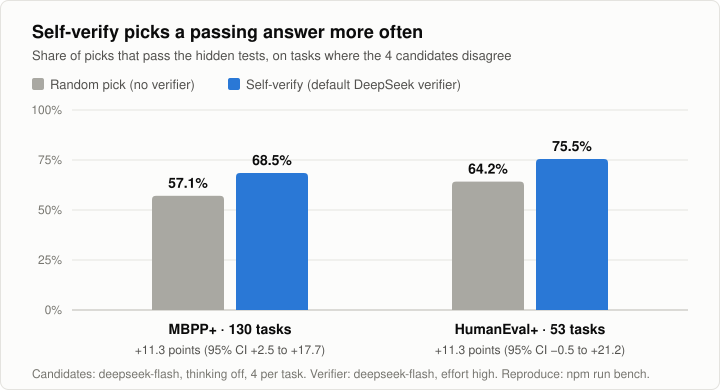

# pi-llm-self-verify

A Pi package that generates independent, read-only candidate solutions and
selects the strongest one with a fine-grained logprob verifier.

Self-verify is a **selection aid**. It does not implement or modify task files,
run project tests, approve changes, replace independent review, or authorize
commits and pushes. It writes the local ignored artifacts documented below.

## Does it help?



On coding tasks where the four candidates disagree, the default verifier picks
a candidate that passes the hidden tests about 11 points more often than a
random pick. When every candidate passes, or none does, selection cannot change
the outcome, so the gain across all tasks is smaller. On HumanEval+ the 95%
interval still reaches slightly below zero. Run `npm run bench` to reproduce
these numbers (see [Benchmark](#benchmark)).

## Install

From this repository while developing:

```bash
pi install /absolute/path/to/pi-llm-self-verify
```

Current release candidate from Git:

```bash
pi install git:github.com/andrasat/pi-llm-self-verify@v0.1.0-rc.4
```

Use `-l` with either command to write the package to the current project's
`.pi/settings.json` instead of the global settings.

Git-tagged installation is the release path; npm publishing is optional:

```bash
npm run check
git add . && git commit -m "Release v0.1.0"
git push origin main
git tag -a v0.1.0 -m "Release v0.1.0"
git push origin v0.1.0
```

Do not publish until the tag and Git installation have been tested in a clean
project. `npm publish --access public` can be added later for npm users.

## Use

After installation, either call the `self_verify` tool from the agent or run:

```text
/self-verify implement a safe change to the authentication boundary
```

With no argument, `/self-verify` uses the latest user task in the session.
The package also provides `/skill:self-verify` for agents that need the
workflow instructions explicitly.

Defaults are three candidates, two repeated evaluations per criterion, and one
pivot. Put non-secret defaults in `.pi/settings.json` or
`~/.pi/agent/settings.json`:

```json
{
  "verify": {
    "candidates": 3,
    "evals": 2,
    "pivots": 1,
    "model": "deepseek-v4-flash",
    "provider": "deepseek",
    "topLogprobs": 20,
    "maxTokens": 32768,
    "effort": "high",
    "project": "my-gcp-project",
    "location": "global",
    "thinkingBudget": 0
  }
}
```

This is the complete safe settings template. `effort` applies only to
DeepSeek; `project`, `location`, and `thinkingBudget` apply only to Vertex.
Delete fields for backends you do not use. Project settings override global
settings. For matching values, precedence is tool argument, environment,
project setting, global setting, then the default.

Endpoint and authentication values are deliberately environment/Pi-auth only:
a repository settings file must not select where a stored credential is sent.

| Variable | Settings key | Purpose |
| --- | --- | --- |
| `VERIFIER_PROVIDER` | `provider` | `vertex` for Vertex Gemini; optionally `together`, `cerebras`, `fireworks`, `openrouter`, or `openai-compatible` |
| `VERIFIER_MODEL` | `model` | Verifier model id |
| `VERIFIER_TOP_LOGPROBS` | `topLogprobs` | Alternatives per token, `1`–`20` (default `20`) |
| `VERIFIER_MAX_TOKENS` | `maxTokens` | Generic verifier output budget |
| `VERIFIER_EVALS` | `evals` | Repeated evaluations |
| `VERIFIER_PIVOTS` | `pivots` | Tournament pivots |
| — | `candidates` | Candidate count, `2`–`5`; tool argument is `candidates` |
| `DEEPSEEK_EFFORT` | `effort` | DeepSeek reasoning effort (`off`, `low`, `high`, `max`); `high` is the default, and lower settings select less accurately |
| `DEEPSEEK_MAX_TOKENS` | `maxTokens` | DeepSeek output budget compatibility alias |
| `GOOGLE_CLOUD_PROJECT` or `VERTEX_PROJECT` | `project` | Vertex project id |
| `GOOGLE_CLOUD_LOCATION` or `VERTEX_LOCATION` | `location` | Vertex location, normally `global` |
| `VERTEX_THINKING_BUDGET` | `thinkingBudget` | Vertex thinking tokens, default `0` |
| `VERIFIER_BASE_URL` or `OPENAI_BASE_URL` | — | OpenAI-compatible `/v1` or `/chat/completions` base; environment only |
| `VERIFIER_AUTH_PROVIDER` | — | Explicit Pi `/login` provider id for stored API-key reuse with a custom HTTPS endpoint; environment only |
| `VERTEX_BASE_URL` | — | Full Vertex `:generateContent` URL; environment only |
| `VERIFIER_API_KEY`, `OPENAI_API_KEY`, or `DEEPSEEK_API_KEY` | — | OpenAI-compatible API key; environment/Pi auth only. `VERIFIER_API_KEY` goes to any verifier endpoint; `DEEPSEEK_API_KEY` only to `api.deepseek.com`; `OPENAI_API_KEY` only to `api.openai.com` or the `OPENAI_BASE_URL` endpoint |
| `VERTEX_API_KEY` or `GOOGLE_API_KEY` | — | Vertex API key; environment only |
| `VERTEX_ACCESS_TOKEN` or `GOOGLE_OAUTH_ACCESS_TOKEN` | — | Vertex OAuth access token; environment only |

Without an explicit key, the extension reuses a stored API-key credential
configured with Pi's `/login deepseek` flow. It reads that credential through
Pi's auth API; it does not duplicate or print the auth file. Each verifier
request has a fixed five-minute deadline. OAuth credentials such as
`openai-codex` are valid for candidate generation, but are not interchangeable
with a DeepSeek/OpenAI-compatible logprob API key. Vertex uses
`VERTEX_API_KEY` or Application Default Credentials. OpenAI-compatible remote
endpoints must return usable token `top_logprobs` for both score tags; literal
score text and chosen-token-only responses are rejected. A plain chat endpoint
is not enough for fine-grained scoring. HTTPS is required for remote endpoints;
HTTP is accepted only for localhost development. Redirects are rejected so
credentials cannot be forwarded to another host.

Candidate generation uses the current Pi model and only enables `read`,
`grep`, `find`, and `ls`. The verifier uses the configured endpoint directly.

## Verifier backends

**TypeSafe (optional, cheap).** Set `VERIFIER_PROVIDER=typesafe` and
`TYPESAFE_API_KEY` to score each candidate with a TypeSafe Jev model (default
`jev-1.13.0`, override with `VERIFIER_MODEL=jev-*`). It asks one Correctness
question per candidate instead of running a pairwise tournament, so `evals` and
`pivots` do not apply. On the benchmark it gained about as much over a random
pick as the DeepSeek verifier (+8 to +11 points, wide intervals) at roughly
1/150 of the cost. DeepSeek remains the default.

The verifier accepts any OpenAI-compatible endpoint that returns
`choices[0].logprobs.content` and `top_logprobs`:

| Backend | Base URL | Example model |
| --- | --- | --- |
| DeepSeek | `https://api.deepseek.com` | `deepseek-v4-flash` |
| OpenAI | `https://api.openai.com/v1` | `gpt-4o-mini` |
| Together | `https://api.together.xyz/v1` | `Qwen/Qwen3.5-9B` |
| Cerebras | `https://api.cerebras.ai/v1` | `gpt-oss-120b` |
| OpenRouter | `https://openrouter.ai/api/v1` | provider/model with logprobs |
| Fireworks | `https://api.fireworks.ai/inference/v1` | deployment with logprobs |
| Local vLLM/SGLang | `http://localhost:8000/v1` | served open model |

The selected model must support logprobs; provider compatibility is not
model compatibility. Fireworks deployments commonly allow only five top
alternatives, so set `VERIFIER_TOP_LOGPROBS=5` there. OpenRouter must be
configured to route to a provider/model that accepts the parameter.

Vertex Gemini is also supported directly:

```bash
export VERIFIER_PROVIDER=vertex
export VERIFIER_MODEL=gemini-2.5-flash
export GOOGLE_CLOUD_PROJECT=my-project
export GOOGLE_CLOUD_LOCATION=global
# Choose one:
export VERTEX_API_KEY=...
# or: gcloud auth application-default login
```

Vertex uses `responseLogprobs`/`logprobs` and requires a model/version that
still exposes them. For local or private use, vLLM/SGLang avoids sending
candidate text to a hosted verifier. A normal chat judge without token
logprobs is not equivalent to this fine-grained verifier.

## Migrating an existing local harness

If a project already has `.pi/skills/self-verify.md` and `.pi/verify/verify.py`,
install this package first, then remove those two local files to avoid loading
two workflows. For the existing Yifa checkout:

```bash
cd ~/Projects/your-financial-assistant
pi install /home/andrasat/Projects/pi-llm-self-verify -l
rm -f .pi/skills/self-verify.md .pi/verify/verify.py
```

Keep the existing `verify` settings and ignored artifact paths.

## Artifacts and privacy

Runs write the task, criteria, candidates, winner, and scores to:

```text
.pi/verify/candidates/<run-id>/
.pi/verify/trail.jsonl
```

The trail is intended as a local training/evaluation record and can contain
sensitive prompt or source text. On POSIX, artifact directories are enforced
`0700` and files `0600`. Keep these paths ignored and review your project's data
policy before sharing them.

## Security and contributing

See [SECURITY.md](SECURITY.md) for vulnerability reporting and [CONTRIBUTING.md](CONTRIBUTING.md) for contribution checks.

## Development

```bash
npm install
npm run check
```

`npm run check` runs TypeScript checking, the built-in test suite, and an npm
package dry run. Pi loads the TypeScript entry point directly; no build step or
runtime dependency is bundled.

### Benchmark

`bench/bench.ts` measures how often a verifier picks a candidate that passes the
hidden tests of MBPP+ or HumanEval+ (`BENCH_DATASET=humanevalplus`). It is
development-only and not part of the published package. It needs `uv`,
`DEEPSEEK_API_KEY`, and network access, and it runs model-written Python
locally without a sandbox.

```bash
npm run bench -- setup && npm run bench -- fetch && npm run bench -- selfcheck
BENCH_RUN=nothink BENCH_CANDIDATE_EFFORT=off npm run bench -- generate
BENCH_RUN=nothink npm run bench -- label
BENCH_RUN=nothink npm run bench -- select deepseek
BENCH_RUN=nothink npm run bench -- report
```

The chart above uses candidates generated with thinking off, which makes enough
candidates fail for selection to matter. Comparisons count only tasks where some
candidates pass and some fail. Before running `select`, check the top of
`bench/bench.ts` for the list of verifier methods and their API costs.

## Agentic engineering contract

- Candidate generation is read-only and isolated from repository mutation.
- The selected answer remains subject to normal implementation, tests, and
  independent review.
- Small changes are preferred; prompts and scoring behavior have focused tests.
- CI runs the same `npm run check` gate as local development.

## License

MIT. See [LICENSE](LICENSE).
